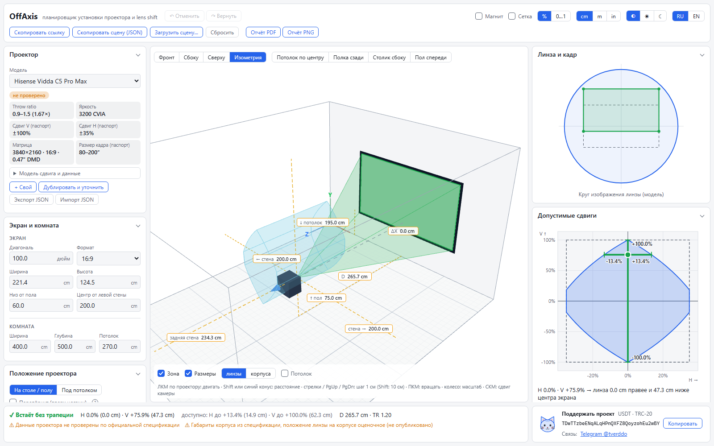

  <picture>
    <source media="(prefers-color-scheme: dark)" srcset="img/logo-dark.svg" />
    
  </picture>

  <b>Will the projector fit without keystone correction when you shift it both vertically and horizontally?</b> 
  A free calculator with a 3D room scene, two-axis lens shift forecast and projector matching for your room.

  <a href="https://offaxis.ru/en/"><b>Open in the browser</b></a> ·
  <a href="https://github.com/SunsetSH/off-axis-releases/releases/latest"><b>Download for Windows and Android</b></a> ·
  <a href="README.md">Русский</a>

## Why

A projector spec says something like "vertical shift ±100%, horizontal ±35%". These limits **do not add up**: the image has to stay inside the lens image circle, so shifting along one axis eats the range of the other. Ordinary throw calculators ignore this. OffAxis shows it: drag the projector in a simple 3D scene or type numbers, and see at once whether it fits without keystone.

## Features

- Interactive 3D scene: room, screen, projector, beam, the zone of allowed positions and a viewer in a chair.
- Two-axis lens shift forecast: how much horizontal shift is left at a given vertical shift, and vice versa. If it does not fit, the app suggests where to move the projector and estimates the keystone needed.
- Brightness in lux, nits and fL for the chosen image size and room type, with plain-language advice.
- Viewing angle rated "Ideal / Good / Poor" (THX, SMPTE) and the distance beyond which pixels blend.
- Projector matching for your room and side-by-side comparison of two projectors.
- Installation report (PDF, PNG) with dimensioned drawings.
- Catalog of projectors (Hisense / Vidda, XGIMI, Dangbei, JMGO, Epson and more) with sources and a "verified / not verified" mark; your own projectors can be added.
- A projector setup guide on the website, [in English](https://offaxis.ru/en/projector-setup-guide/) and [in Russian](https://offaxis.ru/ustanovka-proektora/): placement and height, HDMI ARC sound, focus, brightness, HDR and Dolby Vision, with diagrams. The Setup guide button opens it from the app.
- Russian and English UI, cm / m / inches, light and dark theme, shareable scene links, undo / redo.

## Get it

| Platform    | How                                                                                                       | Requires              |
| ----------- | --------------------------------------------------------------------------------------------------------- | --------------------- |
| **Browser** | [offaxis.ru/en/](https://offaxis.ru/en/), full features, works offline after the first visit              | Any modern browser    |
| **Android** | `.apk` from the [latest release](https://github.com/SunsetSH/off-axis-releases/releases/latest)           | Android 7.0+          |
| **Windows** | `.exe` installer from the [latest release](https://github.com/SunsetSH/off-axis-releases/releases/latest) | Windows 10 / 11 (x64) |

Android package name: `io.github.sunsetsh.offaxis`. The Windows installer is not code-signed, so SmartScreen may warn you ("More info" → "Run anyway"). SHA-256 checksums are listed in every release.

## Data

Calculations rely **only on manufacturer specifications**; no measurements of real projectors were made. Every catalog entry lists its sources, and formulas are shown in the app's "Calculation" panel. Missing a projector or found a mistake? [Open an issue](https://github.com/SunsetSH/off-axis-releases/issues/new/choose).

## About this repository

This is a showcase: description, releases and feedback. The source code is not published. The app is free for personal use, see [LICENSE](LICENSE). Discussion (Russian): [4PDA topic](https://4pda.to/forum/index.php?showtopic=1128255). Changelog: [CHANGELOG.md](CHANGELOG.md). Author: [SunsetSH](https://github.com/SunsetSH).
