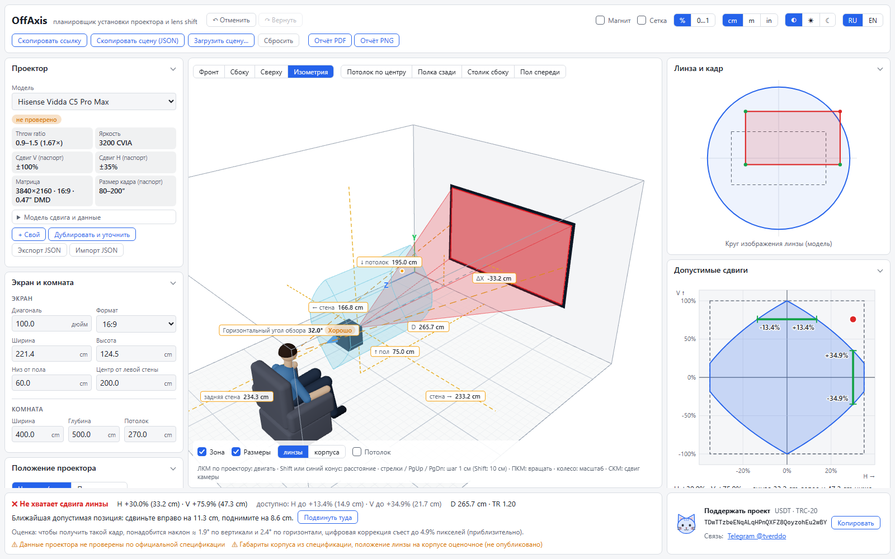
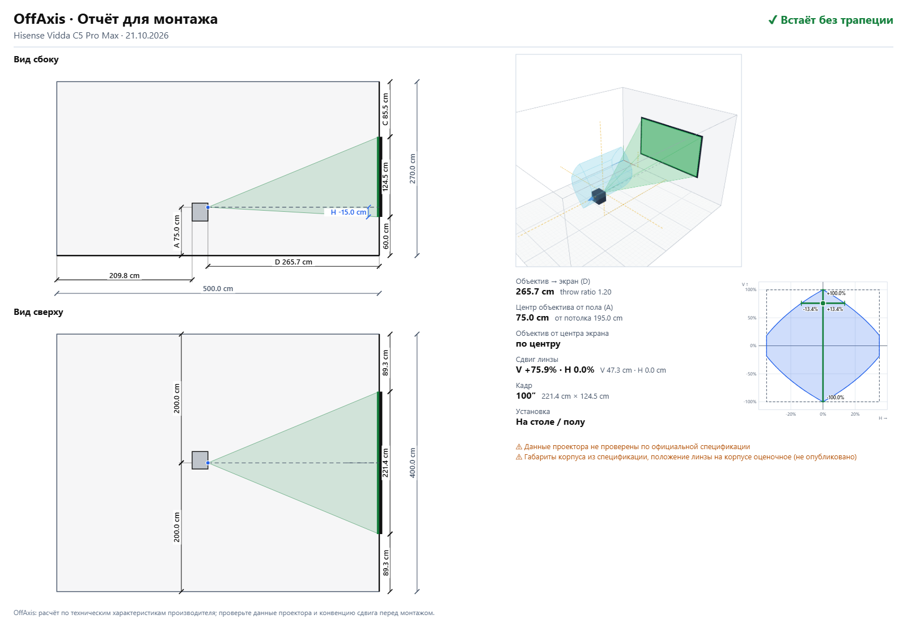
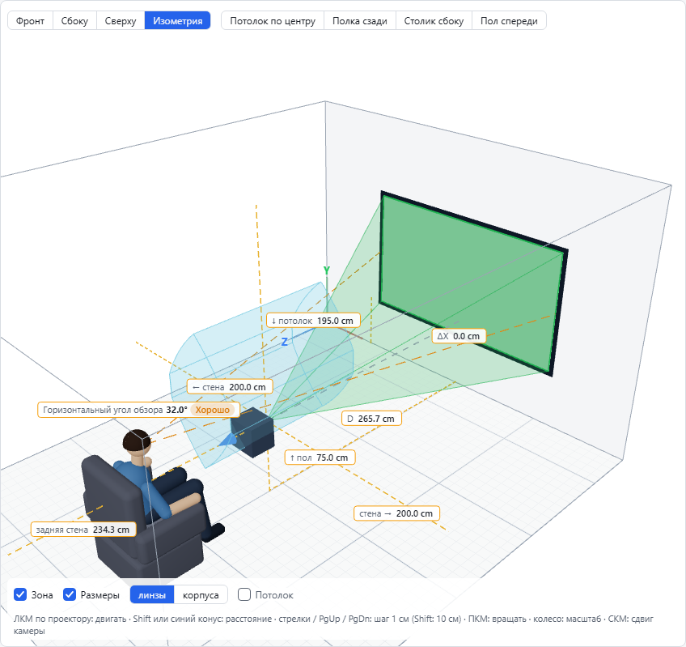
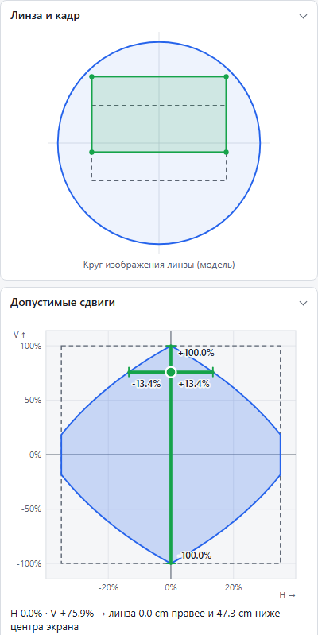

  <picture>
    <source media="(prefers-color-scheme: dark)" srcset="img/logo-dark.svg" />
    
  </picture>

  <b>Встанет ли проектор без коррекции трапеции, если сдвинуть его и по вертикали, и по горизонтали?</b> 
  Бесплатный калькулятор с 3D-сценой, расчётом сдвига объектива по двум осям сразу и подбором проектора под вашу комнату.

  <a href="https://offaxis.ru/"><b>Открыть в браузере</b></a> ·
  <a href="https://github.com/SunsetSH/off-axis-releases/releases/latest"><b>Скачать для Windows и Android</b></a> ·
  <a href="README.en.md">English</a>

## Зачем это нужно

В паспорте проектора пишут что-то вроде «сдвиг по вертикали ±100%, по горизонтали ±35%». Но эти пределы **нельзя складывать**: кадр должен поместиться в круг изображения объектива, поэтому сдвиг по одной оси съедает запас по другой. Обычные калькуляторы расстояния этого не учитывают, и проектор, который «по паспорту должен встать», на деле даёт трапецию.

OffAxis показывает это наглядно: вы двигаете проектор мышью в простой 3D-сцене или вводите числа, и сразу видите, встанет ли он ровно.

## Что умеет

- **3D-сцена комнаты.** Экран, проектор, луч, зона допустимых положений и зритель в кресле. Проектор двигается мышью, клавишами или кнопками, размеры до стен, пола и потолка редактируются.
- **Прогноз сдвига объектива по двум осям сразу.** Диаграмма показывает, сколько осталось по горизонтали при заданном сдвиге по вертикали, и наоборот. Если проектор не встаёт, программа подскажет, куда его подвинуть, и оценит нужную коррекцию трапеции.
- **Яркость с понятными советами.** Освещённость экрана в люксах, нитах и fL для выбранного размера кадра и типа комнаты (тёмная, полутёмная, светлая).
- **Расстояние до зрителя.** Горизонтальный угол обзора с оценкой «Идеально / Хорошо / Плохо» по рекомендациям THX и SMPTE и дистанция, дальше которой пиксели неразличимы.
- **Подбор проектора под ваше место.** Вводите размеры комнаты, экран и ограничения (потолок, полка), а программа показывает, какие модели встанут без трапеции, а какие нет и почему.
- **Сравнение двух проекторов** в одной комнате: вердикт, зум, запас по сдвигу, допустимое расстояние, яркость.
- **Отчёт для монтажа** в PDF и PNG: чертежи с размерами, вид сбоку и сверху, диаграмма сдвигов.
- **Каталог проекторов** Hisense / Vidda, XGIMI, Dangbei, JMGO, Epson и других с источниками характеристик и пометкой «проверено / не проверено». Можно добавить свой проектор.
- Русский и английский интерфейс, сантиметры, метры и дюймы, светлая и тёмная тема, ссылка на готовую сцену, отмена и повтор действий.

## Скриншоты

|                                                                                           |                                                                                        |
| ----------------------------------------------------------------------------------------- | -------------------------------------------------------------------------------------- |
|  |                            |
| _Если сдвига не хватает, программа подсказывает, куда подвинуть проектор_                 | _Отчёт для монтажа: размеры, виды сбоку и сверху_                                      |
|                     |  |
| _3D-сцена: комната, экран, проектор, луч и зритель_                                       | _Допустимые сдвиги: чем больше по вертикали, тем меньше по горизонтали_                |

## Где взять

| Платформа   | Как получить                                                                                                              | Требуется                 |
| ----------- | ------------------------------------------------------------------------------------------------------------------------- | ------------------------- |
| **Браузер** | Откройте [offaxis.ru](https://offaxis.ru/): полный функционал, без установки (работает и без сети после первого открытия) | Любой современный браузер |
| **Android** | Файл `.apk` из [последнего релиза](https://github.com/SunsetSH/off-axis-releases/releases/latest)                         | Android 7.0 и выше        |
| **Windows** | Установщик `.exe` из [последнего релиза](https://github.com/SunsetSH/off-axis-releases/releases/latest)                   | Windows 10 и 11 (x64)     |

Имя пакета Android: `io.github.sunsetsh.offaxis`.

**Об установке.** Файлы не подписаны сертификатом издателя Windows, поэтому SmartScreen может показать предупреждение «Windows защитила ваш компьютер»: нажмите «Подробнее» → «Всё равно запустить». На Android потребуется разрешить установку из этого источника. Контрольные суммы SHA-256 указаны в описании каждого релиза, их можно сверить.

## Откуда берутся данные

Расчёт строится **только на технических характеристиках** из спецификаций производителей, замеров на реальных проекторах нет. У каждой модели в каталоге указаны источники, а пометка «проверено» означает, что цифры сверены с официальной спецификацией. Формулы и промежуточные значения видны в панели «Расчёт» прямо в программе.

Нет нужного проектора или нашли неточность в данных? [Создайте обращение](https://github.com/SunsetSH/off-axis-releases/issues/new/choose): достаточно названия модели и ссылки на спецификацию.

## Обратная связь

- Ошибки и пожелания: [Issues](https://github.com/SunsetSH/off-axis-releases/issues/new/choose)
- Обсуждение на 4PDA: [тема OffAxis](https://4pda.to/forum/index.php?showtopic=1128255)
- Telegram: [@tverddo](https://t.me/tverddo)
- История версий: [CHANGELOG.md](CHANGELOG.md)
- Политика конфиденциальности: [offaxis.ru/privacy/](https://offaxis.ru/privacy/)

## Об этом репозитории

Это витрина программы: описание, релизы и обратная связь. Исходный код не публикуется. Программа бесплатна для личного использования, условия в файле [LICENSE](LICENSE).

Автор: [SunsetSH](https://github.com/SunsetSH)
